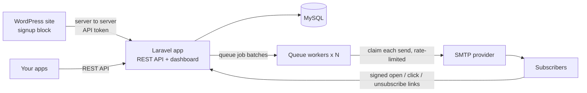

# Postbag

**A self-hosted newsletter platform, with a WordPress plugin.** Manage lists and subscribers, write
campaigns in Markdown, and send them through any SMTP provider. Postbag handles double opt-in,
one-click unsubscribe, bounces, and open and click tracking, and sends through queues so nobody gets
the same email twice. Built with Laravel 13, MySQL and Blade.

[](https://github.com/qaweem321/postbag/actions/workflows/ci.yml)


## Features

- **Lists and subscribers.** Double or single opt-in per list, signup source tracking, search and filters.
- **Campaigns** written in Markdown, with `{{ name }}` personalization, a live preview, test emails,
  scheduling (in UTC) and cancelling.
- **Reliable sending.** Recipients are frozen in one SQL statement, each email is claimed before it is
  sent, and a rate limiter keeps all workers under your provider's limit. Nobody is emailed twice,
  even if a job runs again.
- **Deliverability basics.** Confirmation emails with signed, expiring links. RFC 8058 one-click
  unsubscribe headers (required by Gmail and Yahoo). Bounces and spam complaints suppress an address
  on every list.
- **Statistics.** Delivered, opened, clicked, unsubscribed, and clicks per link, from signed tracking
  URLs that can't be faked or used as open redirects.
- **Light, dark or system theme** for the dashboard, chosen in Settings and remembered in the browser.
- **REST API** with Sanctum tokens (read/write abilities), cursor pagination, rate limits and an
  [OpenAPI description](docs/openapi.yaml) kept in sync by a test.
- **WordPress plugin** ([wordpress-plugin/](wordpress-plugin/)): a Newsletter signup block and
  `[postbag_signup]` shortcode, a settings page with a live connection check, spam protection without
  CAPTCHAs, and WP-CLI commands.

## Quick start

You need Docker, Node 24 and `make`.

```bash
git clone https://github.com/qaweem321/postbag.git
cd postbag
make up     # MySQL, app, queue worker, scheduler, Mailpit
make seed   # demo data
```

- Dashboard: http://localhost:8080 (log in as `admin@example.com` / `postbag-demo`)
- Mailpit, where every email lands: http://localhost:8025

Open **Campaigns → Weekly digest #42**, send it, and watch 102 emails arrive in Mailpit. Click a link in
one of them and the campaign's statistics update.

**With WordPress:**

```bash
make wordpress   # demo site at http://localhost:8081 (admin / admin), plugin installed and connected
```

Add the **Newsletter signup** block to a page, subscribe, and confirm from the email in Mailpit.

These passwords are for local use only.

## How it works



The reasoning behind each part, with trade-offs, is in [docs/DECISIONS.md](docs/DECISIONS.md).

## API example

```bash
curl -X POST http://localhost:8080/api/v1/lists/<list-id>/subscribers \
  -H "Authorization: Bearer <token>" -H "Accept: application/json" \
  -d email=jane@example.com -d name=Jane
```

```json
{ "data": { "id": "01a1…", "email": "jane@example.com", "status": "pending", "source": "api" }, "outcome": "pending_confirmation" }
```

Create tokens on the **API tokens** page. Full reference: [docs/openapi.yaml](docs/openapi.yaml).

## Development

Everything runs in Docker; PHP and Composer don't need to be installed.

| Command          | What it does                                                         |
| ---------------- | -------------------------------------------------------------------- |
| `make test`      | Pest (Laravel, on MySQL) and PHPUnit (WordPress plugin, Brain Monkey) |
| `make lint`      | Pint, PHPStan level 8 (Larastan) and WordPress Coding Standards      |
| `make format`    | Format PHP with Pint                                                 |
| `make worker-logs` | Follow the queue worker                                            |
| `docker compose run --rm app php artisan postbag:create-user you@example.com` | Create a dashboard user |

Commits follow [Conventional Commits](https://www.conventionalcommits.org/), checked by commitlint in a
husky hook (`npm ci` once). The pre-commit hook formats staged PHP with Pint.

## Configuration

Standard Laravel settings in `.env` (database, `MAIL_*` for your SMTP provider, `QUEUE_CONNECTION`), plus:

| Variable                    | Default | Notes                                              |
| --------------------------- | ------- | -------------------------------------------------- |
| `POSTBAG_BATCH_SIZE`        | `100`   | Recipients per queued job                          |
| `POSTBAG_EMAILS_PER_MINUTE` | `600`   | Across all workers, to respect provider limits     |
| `MAIL_FROM_NAME/ADDRESS`    |         | Default sender for new campaigns                   |

**Production:** build the `app` target of `docker/Dockerfile` (Apache, OPcache, unprivileged user). Run the
same image three times: the web server (default command), `php artisan queue:work`, and
`php artisan schedule:work`. Run `php artisan migrate --force` on deploy.

## Tech

PHP 8.4, Laravel 13, Eloquent, Sanctum, queues and job batches, Blade, MySQL 8.4 · Tailwind CSS 4, Vite ·
WordPress plugin: Settings API, REST API, block (block.json), shortcode, WP-CLI · Pest, PHPUnit,
Brain Monkey, PHPStan/Larastan, Pint, PHP_CodeSniffer with WPCS · Docker, GitHub Actions.

## Maintenance

Postbag is maintained in my spare time. Security reports come first; other issues and pull requests are
welcome, but replies may take a while.

## License

MIT
